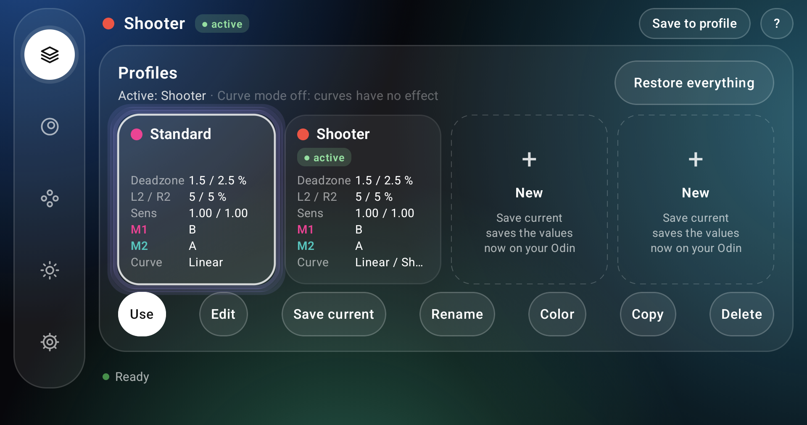
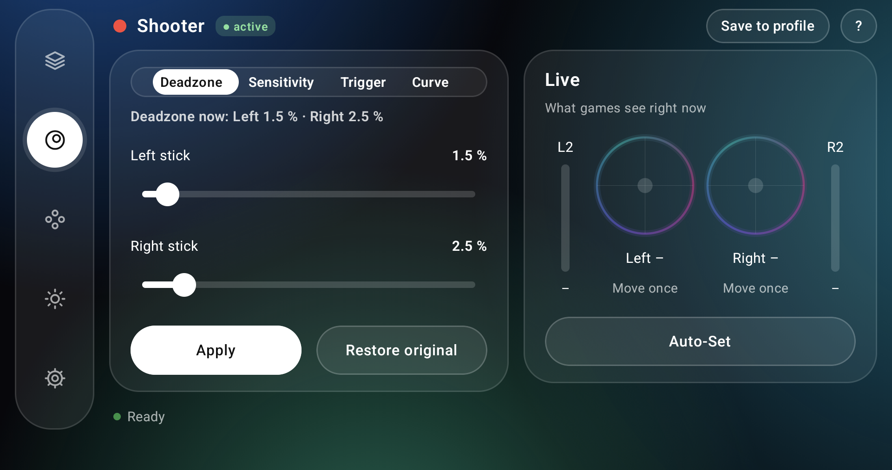
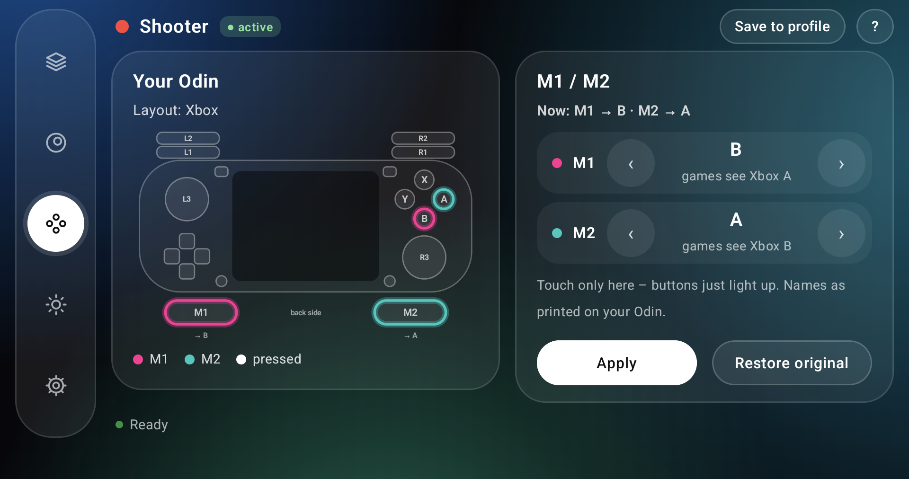
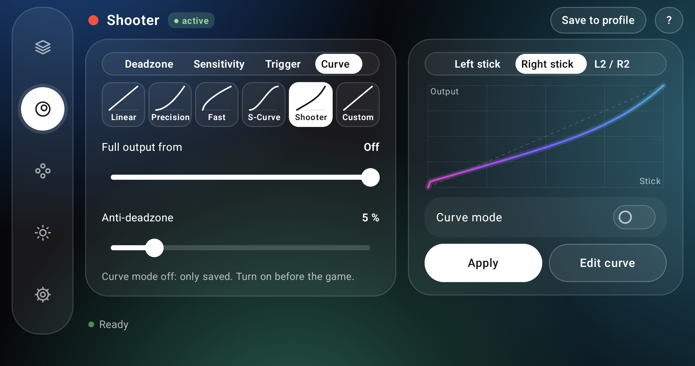
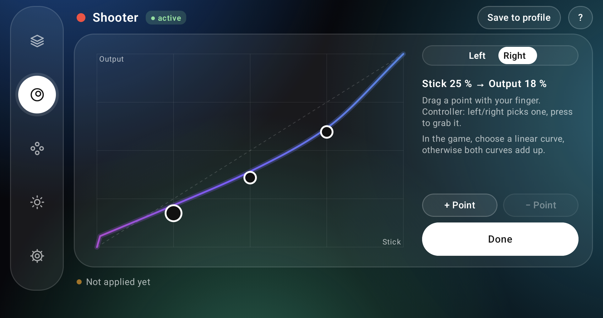

# StickLab

Stick, trigger and button settings for the AYN Odin 3: profiles, response curves and Ambilight. No root needed.

**[Download the latest version](https://github.com/EmuMcLovin/StickLab/releases/latest)** · [What's new](CHANGELOG.md)

## Features

### Sticks and triggers

- **Deadzone:** left and right stick from 0 to 20 % in steps of 0.1 %. It takes effect right away, no restart needed, and stays after a restart. The screen shows the value that is really active.
- **Auto-Set:** move each stick in 8 directions. StickLab measures how far it stays off center after you let go, suggests a deadzone just above that and checks the result before you apply it.
- **Sensitivity and trigger deadzone:** the same ranges as the Odin menu, for each stick and for L2/R2.
- **Live view:** see where the sticks and triggers are, exactly as games get them.

### Curves (with Curve mode)

- **Response curves:** Linear, Precision, Fast, S-Curve and Shooter, or draw your own with 3 to 5 points.
- **Outer deadzone:** full output before the stick reaches the end.
- **Anti-deadzone:** skips the deadzone built into a game, so the stick reacts from the first movement.
- **Full L2/R2 from part of the way:** for example full output at 50 % of the trigger travel.
- **Curve mode (experimental, off by default):** a virtual controller named "StickLab Controller" passes your controller on to games with these settings. Turn it on before the game, because switching during a game can make the game lose the controller. It never starts by itself. To stop it, use the switch, Stop in the notification, or restart your Odin: your normal controller comes back right away. If a game has its own curve, choose linear there, otherwise both apply.

### Profiles and buttons

- **Profiles:** up to 4 named profiles with a color. Each keeps deadzone, sensitivity, trigger deadzone, M1/M2 and curves. Switching sets everything at once and flashes the stick LEDs in the profile color.
- **Quick Settings tile:** tap to switch to the next profile without opening StickLab. Long press opens the app.
- **M1 and M2:** any of the 22 entries of the Odin menu, shown on a picture of your Odin with the names printed on your buttons.
- **Restore everything:** one button brings back every value from before StickLab and stops Curve mode, also when the controller does not respond, because it works by touch.

### Light and look

- **Ambilight:** the stick LEDs follow the colors on screen. The left stick uses the top-left area of the picture, the right stick the bottom-right area. With sliders for brightness, color intensity, white level, speed, green and blue level. Needs the "Joystick light" tile in Quick Settings to be on, StickLab reminds you if it is off.
- **Backgrounds:** choose between Neon, Ocean, Ember and Graphite in the Settings tab.
- **Languages:** English and German.

| | |
| --- | --- |
|  |  |
|  |  |

## Install

1. Download `StickLab-2.0.apk` from the [Releases page](https://github.com/EmuMcLovin/StickLab/releases/latest).
2. Open the file on your Odin 3 and allow the installation.
3. Start StickLab.

**Updating from 1.0:** install it over your current version, you do not need to uninstall anything. Version 2.0 cannot be downgraded without uninstalling it.

## How it works

- Settings are applied through `PServerBinder` and `com.odin.mapping`, system services that are built into the AYN firmware. That is why no root is needed.
- StickLab only uses fixed commands and checks every value against a fixed range before setting it. It never touches the stick calibration or the firmware of the controller chip.
- Curve mode starts a small helper program through the same built-in service, which runs it as root. Your Odin itself does not need to be rooted. The helper comes with the app and is checked against a fixed checksum before every start. It ends when you stop it or when the app is no longer running, and StickLab adds its virtual controller to a list in the AYN system so that AYN's service leaves it alone. "Restore everything" removes that entry.
- For Ambilight, Android gives the app a tiny live copy of the screen (96×54 pixels). The app reads it up to 60 times per second and updates the LEDs up to 40 times per second. The copy is not saved.
- Your profiles stay on your Odin. Nothing is sent anywhere, the app has no internet permission.

## Good to know

- Works only on the AYN Odin 3. On any other device StickLab sends nothing to the device.
- Curve mode only runs on firmware versions it has been tested on, so far 1.0.0.187. On other firmware it stays off, everything else keeps working.
- Curve mode has been tested in games through GameNative, the virtual controller also with GeForce NOW. Other games and emulators may treat it differently, so please report what you find.
- Apps that protect their screen content (for example the YouTube app or Netflix) are seen as black, so the LEDs stay dark. YouTube in the browser works.
- The switch "Don't ask again" skips the Android screen capture prompt. It is off by default.
- Before you uninstall StickLab, press "Restore everything". It sets your values back and takes the virtual controller's entry out of the AYN system. An app cannot do that while it is being removed.
- Use at your own risk. This project is not affiliated with AYN.

## Credits

The call format for `PServerBinder` is documented by ClusterTune (AurelioB), which credits O2P Tweaks (FeralAI).

## License

[MIT](LICENSE)
